# Kiến trúc kỹ thuật — Ninh Trang ERP

Sơ đồ cho người sửa mã: hệ thống gồm những khối nào, một yêu cầu đi qua những lớp nào, dữ liệu nằm ở đâu và các quy tắc lõi (tồn kho, giá vốn, công nợ, nhật ký) được giữ ở chỗ nào. Nghiệp vụ từng màn hình xem ở [`docs/atlas`](docs/atlas/src/ATL-00_Workflow-he-thong.md); cách chạy, biến môi trường và quy ước sửa mã xem ở [`README.md`](README.md).

## Mục lục

1. [Tổng thể hệ thống](#1-tổng-thể-hệ-thống)
2. [Đường đi của một yêu cầu API](#2-đường-đi-của-một-yêu-cầu-api)
3. [Backend: module và dịch vụ lõi](#3-backend-module-và-dịch-vụ-lõi)
4. [Frontend: lớp và luồng dữ liệu](#4-frontend-lớp-và-luồng-dữ-liệu)
5. [Mô hình dữ liệu](#5-mô-hình-dữ-liệu)
6. [Tồn kho và giá vốn](#6-tồn-kho-và-giá-vốn)
7. [Công nợ và quỹ tiền tính khi đọc](#7-công-nợ-và-quỹ-tiền-tính-khi-đọc)
8. [Vòng đời chứng từ chính](#8-vòng-đời-chứng-từ-chính)
9. [Nhiều doanh nghiệp](#9-nhiều-doanh-nghiệp)
10. [Build, CI, triển khai và sao lưu](#10-build-ci-triển-khai-và-sao-lưu)
11. [Bản đồ thư mục](#11-bản-đồ-thư-mục)

---

## 1. Tổng thể hệ thống

Một web service duy nhất trên Render: NestJS vừa phục vụ API dưới `/api`, vừa trả file tĩnh của Angular (mọi đường dẫn khác trả `index.html`). Dữ liệu ở PostgreSQL trên Neon; ở chế độ nhiều doanh nghiệp mỗi doanh nghiệp một database.

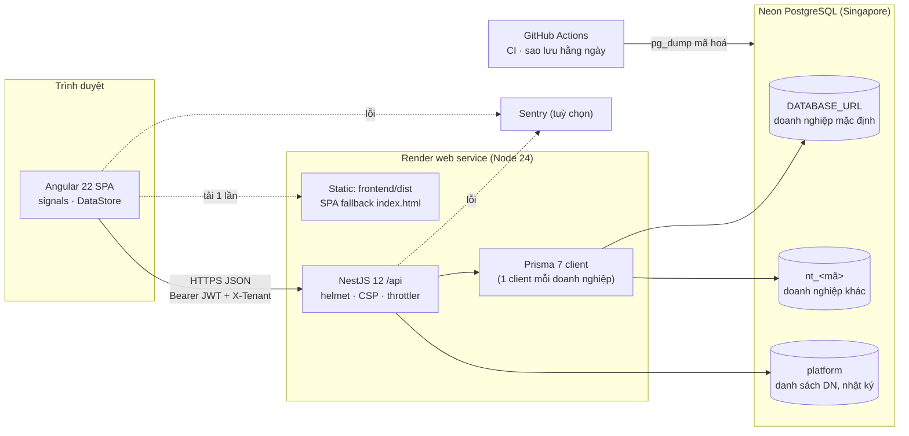

| Thành phần | Công nghệ | Ghi chú |
|---|---|---|
| Giao diện | Angular 22, standalone components, signals, lazy routes | Font tự host (Be Vietnam Pro, JetBrains Mono); `design.md` là hệ thống thiết kế |
| API | NestJS 12 (Express), class-validator | Tiền tố `/api`; body JSON tối đa 10 MB |
| ORM | Prisma 7 | `PrismaService` là proxy chuyển mọi lời gọi tới client của doanh nghiệp đang xử lý |
| CSDL | PostgreSQL 17 (Neon) | 21 migration; cột tiền / số lượng là `Decimal`, ngày chứng từ là `@db.Date` |
| Kiểm thử | Vitest (unit + e2e trên Postgres thật), Playwright (`tools/qa`) | e2e chặn mọi lệnh ghi thiếu nhật ký |

---

## 2. Đường đi của một yêu cầu API

Mọi lệnh ghi đi qua cùng một chuỗi: xác định doanh nghiệp → xác thực → kiểm quyền → một giao dịch Prisma (khoá dòng, ghi kho, cấp mã, ghi nhật ký) → chuẩn hoá phản hồi.

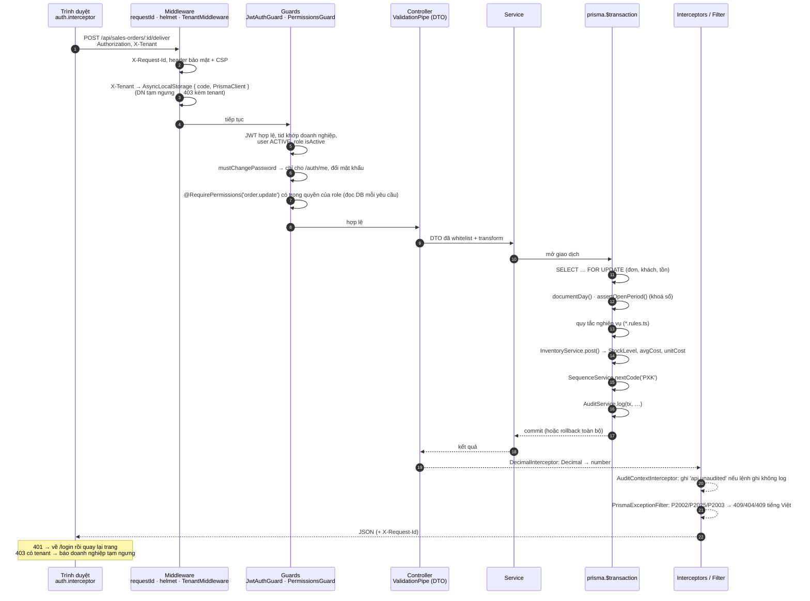

**Điểm chặn quan trọng**

| Lớp | File | Việc |
|---|---|---|
| Request id | `backend/src/monitoring/request-id.ts` | Gắn `X-Request-Id`, ghi cùng mã vào nhật ký và log lỗi |
| Doanh nghiệp | `backend/src/platform/tenant.middleware.ts`, `tenant.context.ts` | So đường dẫn ở dạng chữ thường; đặt client Prisma vào `AsyncLocalStorage` |
| Xác thực | `backend/src/auth/jwt.strategy.ts`, `jwt-auth.guard.ts` | Token 12 giờ; từ chối token khác doanh nghiệp; buộc đổi mật khẩu |
| Thử đăng nhập | `backend/src/auth/login-throttle.ts` | Mặc định 30 lần / 5 phút / IP, 8 lần / 15 phút / IP + email |
| Phân quyền | `backend/src/auth/permissions.guard.ts` | `@RequirePermissions(...)` trên từng route |
| Phạm vi dữ liệu | `modules/sales/order-access.ts`, `common/purchase-prices.ts` | Người bán chỉ thấy đơn của mình; ẩn giá nhập / giá vốn theo quyền |
| Nhật ký | `backend/src/audit/` | `AuditService.log(tx)` cùng giao dịch; bảng `AuditLog` có trigger chặn UPDATE/DELETE/TRUNCATE |
| Lỗi | `common/prisma-exception.filter.ts`, `monitoring/error-report.interceptor.ts` | Thông báo tiếng Việt; gửi Sentry khi bật |

---

## 3. Backend: module và dịch vụ lõi

Các module nghiệp vụ không tự sửa tồn kho, tự cấp mã hay tự tính số dư: chúng gọi chung vài dịch vụ lõi. Mũi tên = "gọi tới".

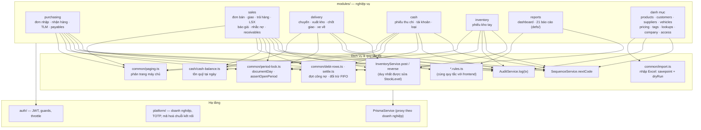

| Module | Đường dẫn API chính | Ghi chú |
|---|---|---|
| `access` | `/users`, `/roles` | Người dùng, chức vụ, phiên |
| `products`, `pricing` | `/products`, `/product-costs`, `/price-lists`, `/promotions` | `avgCost` không bao giờ đi ra cùng hàng hoá |
| `customers`, `suppliers` | `/customers`, `/suppliers` (+ `/import`) | Nhập Excel chạy thử từng dòng |
| `inventory` | `/warehouse-vouchers` (+ `/page`, `/usage`) | Phiếu tay; phiếu sinh từ chứng từ khác chỉ huỷ ở gốc |
| `purchasing` | `/purchase-orders` (+ `/receive`, `/returns`), `/payables` | |
| `sales` | `/sales-orders` (+ `/deliver`, `/returns`, `/page`, `/issued-costs`), `/production-orders`, `/quotations`, `/debt-reminders`, `/receivables` | |
| `delivery` | `/delivery-trips` | Tải lên xe lưu theo dòng đơn (`DeliveryTripLoad`) |
| `cash` | `/cash-vouchers`, `/cash-accounts`, `/cash-categories` | Không lưu số dư |
| `reports` | `/dashboard`, `/reports/:slug` | Mỗi báo cáo một hàm trong `reports/defs` |
| `audit` | `/audit-logs`, `/audit-logs/entity/:type/:id` | Chỉ đọc |
| `platform` | `/platform/*` | Phiên riêng, không dùng được cho API doanh nghiệp |

---

## 4. Frontend: lớp và luồng dữ liệu

Sau đăng nhập, `CatalogLoader` nạp danh mục và chứng từ gần đây vào `DataStore` (signals); màn hình đọc từ store, danh sách lớn gọi trang máy chủ, chứng từ cũ đọc khi cần.

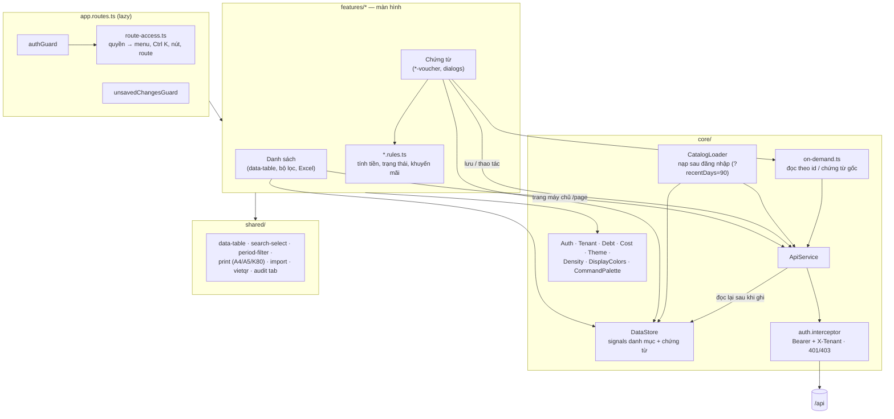

- **Quy tắc tính tiền chạy hai nơi:** `features/sales-orders/sales-order.rules.ts` và `backend/src/modules/sales/sales-order.rules.ts` giống nhau; `sales-order.parity.spec.ts` so kết quả trên 500 đơn ngẫu nhiên. Màn hình báo lỗi sớm, máy chủ quyết định.
- **Phân quyền giao diện** chỉ ẩn; máy chủ vẫn kiểm mọi lời gọi.
- **Còn tính trên phần đã nạp:** tìm nhanh Ctrl K, nút đơn trước / sau, giá nhập gần nhất khi lập đơn nhập.

---

## 5. Mô hình dữ liệu

49 bảng. Sơ đồ dưới giữ các bảng chứng từ và quan hệ chính (bỏ bảng phụ như ảnh, thẻ, địa chỉ).

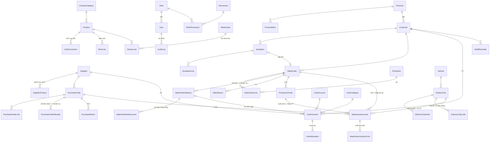

**Quy ước dữ liệu**

| Quy ước | Ở đâu |
|---|---|
| Không xoá chứng từ: `isCancelled`; danh mục: `isActive = false` | mọi bảng chứng từ / danh mục |
| Mã chứng từ chỉ cấp qua `SequenceService.nextCode` (bảng `DocumentSequence`, nguyên tử, đồng bộ khi khởi động) | `backend/src/prisma/sequence.service.ts` |
| Không có cột số dư: công nợ, tồn quỹ, tổng tiền đơn đều suy ra | `common/settle.ts`, `debt-rows.ts`, `cash-balance.ts` |
| Khoá lạc quan khi sửa: gửi `updatedAt` đã đọc, khác thì 409 "vừa được người khác lưu" | đơn nhập, đơn bán, báo giá |
| Ngày chứng từ `@db.Date`, gửi `YYYY-MM-DD`, "hôm nay" theo `Asia/Ho_Chi_Minh` (`vnDay()`) | `common/text.ts` |

---

## 6. Tồn kho và giá vốn

Mọi thay đổi tồn đi qua `InventoryService.post(tx, …)` trong giao dịch của chứng từ gốc; huỷ đi qua `reverse`. Giá vốn là bình quân gia quyền di động trên toàn bộ kho, chốt vào từng dòng phiếu.

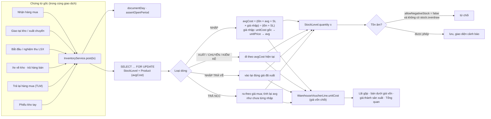

- Thành phẩm nhập kho theo chi phí vật tư đã xuất của lệnh ÷ số làm được.
- `avgCost` và `unitCost` không bao giờ được gửi ra cùng hàng hoá hay phiếu kho; `GET /api/product-costs` chỉ trả cho người có `product.view_cost_price` / `stock.view_value`.

---

## 7. Công nợ và quỹ tiền tính khi đọc

Không bảng nào lưu số dư. Khi đọc, máy chủ dựng danh sách khoản nợ từ các đợt giao / nhận và trả hàng, rồi đối trừ bằng phiếu thu chi.

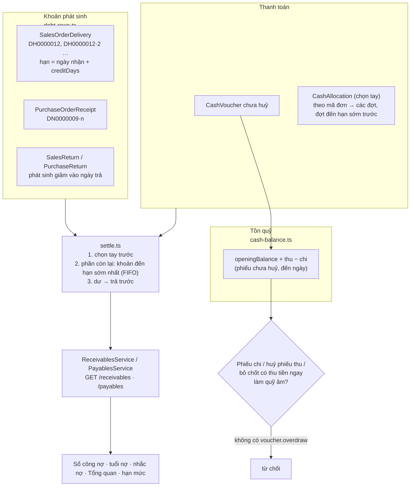

Hạn mức công nợ được kiểm trong giao dịch lưu đơn, sau khi khoá dòng khách hàng, nên hai đơn lưu cùng lúc không cùng lọt.

---

## 8. Vòng đời chứng từ chính

Trạng thái đơn bán không lưu tay mà suy ra từ giao hàng và sản xuất (`sales-order.rules.ts`).

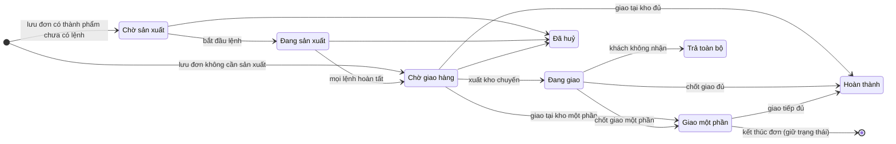

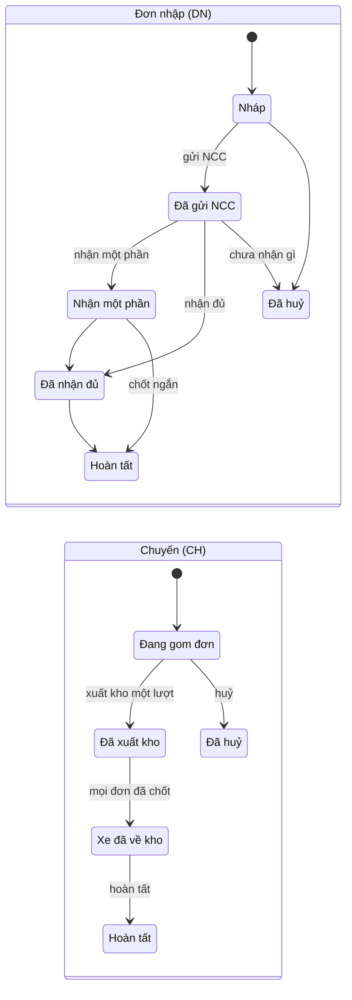

---

## 9. Nhiều doanh nghiệp

Bật khi có `PLATFORM_DATABASE_URL`; không có thì chạy như một doanh nghiệp trên `DATABASE_URL`.

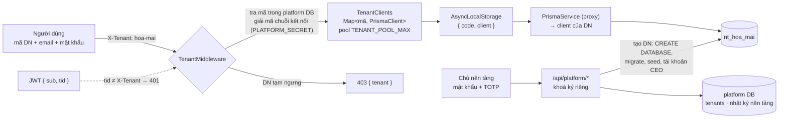

Khởi động: `prisma migrate deploy` (DB mặc định) → `bootstrap.ts` (seed nếu trống) → `migrate-tenants.ts` (migrate mọi doanh nghiệp; lỗi ghi vào trạng thái doanh nghiệp, không chặn khởi động).

---

## 10. Build, CI, triển khai và sao lưu

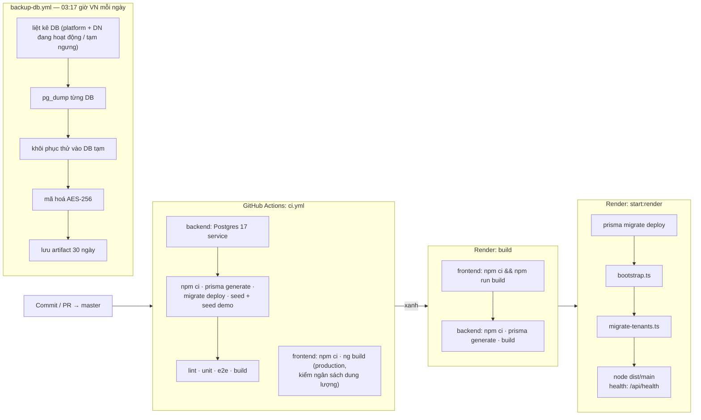

- Một file style component quá 16 kB làm build production thất bại; tách thành nhiều `styleUrls` thay vì nâng ngân sách.
- Quyền mới phải thêm ở ba nơi: `backend/prisma/seed.ts`, `frontend/src/app/core/data/permission-catalog.ts` và một migration cấp quyền cho chức vụ có sẵn (test `permission-matrix` so khớp).

---

## 11. Bản đồ thư mục

```
backend/
  prisma/            schema.prisma · migrations/ · seed.ts · seed-demo.ts · bootstrap.ts · migrate-tenants.ts
  src/
    main.ts          helmet, static SPA, prefix /api, ValidationPipe
    app.module.ts    nối module; DecimalInterceptor, ErrorReportInterceptor, PrismaExceptionFilter
    auth/            đăng nhập, JWT, guards, throttle
    audit/           AuditService, AuditContextInterceptor, /audit-logs
    platform/        nhiều doanh nghiệp: middleware, clients, TOTP, secret-box
    prisma/          PrismaService (proxy), SequenceService
    common/          settle, debt-rows, period-lock, paging, import, decimal, purchase-prices, text
    monitoring/      request-id, health, Sentry
    modules/         access · company · tags · lookups · products · pricing · customers · suppliers ·
                     vehicles · inventory · purchasing · sales · delivery · cash · reports
  test/              e2e trên Postgres thật (permission-matrix, audit-coverage, period-and-returns, …)
frontend/src/app/
  app.routes.ts      route lazy + guards
  core/              api/ (ApiService, CatalogLoader, on-demand, interceptor) · auth/ (route-access) ·
                     services/ (DataStore, Auth, Tenant, Debt, Cost…) · models/ · data/ (permission-catalog)
  features/          một thư mục mỗi phân hệ: danh sách, *-voucher, dialogs, *.rules.ts
  shared/            data-table, search-select, print, import, vietqr, audit, period-filter…
  layout/            shell, menu (nav-items.ts), command-palette (Ctrl K), account-menu
tools/
  atlas/             dựng tài liệu Atlas (.docx + trang HTML) từ docs/atlas/src
  backup/            giải mã chuỗi kết nối cho workflow sao lưu
  qa/                Playwright mở mọi trang theo chức vụ; xuất báo cáo kiểm thử
docs/atlas/          tài liệu nghiệp vụ từng màn hình (ATL-00 → ATL-34)
```
