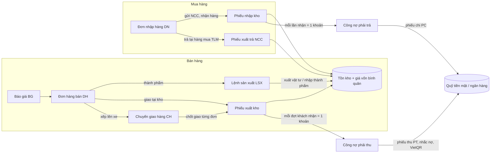
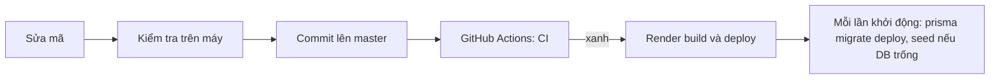

# Ninh Trang ERP

Phần mềm quản lý bán hàng, kho, sản xuất, giao hàng, công nợ và thu chi cho một doanh nghiệp sản xuất và kinh doanh khung tranh, kính, nhôm. Giao diện tiếng Việt, chạy trên trình duyệt, dữ liệu nằm trên máy chủ (PostgreSQL); mỗi người dùng chỉ thấy và làm được những gì chức vụ của họ cho phép.

- **Frontend:** Angular 22 (`frontend/`)
- **Backend:** NestJS 12 + Prisma 7 + PostgreSQL (`backend/`)
- **Triển khai:** một web service trên Render phục vụ cả giao diện lẫn `/api`, cơ sở dữ liệu trên Neon (`render.yaml`)
- **Tài liệu từng màn hình:** `docs/atlas/` (bắt đầu từ [`ATL-00_Workflow-he-thong.docx`](docs/atlas/ATL-00_Workflow-he-thong.docx))
- **Hệ thống thiết kế giao diện:** [`design.md`](design.md)

## Mục lục

1. [Quy trình nghiệp vụ chính](#quy-trình-nghiệp-vụ-chính)
2. [Các phân hệ](#các-phân-hệ)
3. [Chạy trên máy](#chạy-trên-máy)
4. [Quy trình làm việc với mã nguồn](#quy-trình-làm-việc-với-mã-nguồn)
5. [Triển khai](#triển-khai-render--neon)
6. [Vận hành](#vận-hành)
7. [Quy ước bắt buộc khi sửa mã](#quy-ước-bắt-buộc-khi-sửa-mã)
8. [Ghi chú kỹ thuật theo phân hệ](#ghi-chú-kỹ-thuật-theo-phân-hệ)
9. [Chưa làm](#chưa-làm)

## Quy trình nghiệp vụ chính

Mọi chứng từ đi theo một chiều: **lập → duyệt / thực hiện → ghi kho → ghi công nợ → thu / chi tiền**. Không chứng từ nào bị xoá: sai thì huỷ (phiếu vẫn còn, đánh dấu huỷ) và lập lại, nên lịch sử và Nhật ký hoạt động luôn đầy đủ.



**Bán hàng.** Sale lập báo giá (`BG…`) theo bảng giá của khách và khuyến mãi đang chạy, rồi chuyển báo giá thành đơn hàng bán (`DH…`). Lập đơn **chưa** trừ kho và **chưa** ghi công nợ. Dòng thành phẩm cần làm thì lập lệnh sản xuất (`LSX…`): bắt đầu = xuất vật tư theo định mức, nghiệm thu = nhập thành phẩm vào kho. Giao hàng có hai cách: giao tại kho (phiếu xuất ngay) hoặc xếp đơn lên chuyến xe (`CH…`), xuất kho một lượt, tài xế chốt số khách thực nhận, hàng khách không nhận được nhập lại khi xe về. Mỗi đợt khách nhận hàng ghi **một khoản công nợ phải thu** với hạn thanh toán riêng; "Thu tiền ngay" thì tự lập phiếu thu. Khách trả hàng thì lập phiếu trả hàng (`TH…`): hàng về kho, công nợ giảm.

**Mua hàng.** Đơn nhập hàng (`DN…`) đi Nháp → Gửi NCC → Nhận một phần / Nhận đủ → Hoàn tất. Mỗi lần nhận hàng ghi phiếu nhập kho theo giá mua và **một khoản công nợ phải trả**. Hàng nhận sai hoặc lỗi thì "Trả lại hàng mua" (`TLM…`): xuất kho theo giá mua, công nợ phải trả giảm. Tồn kho xuống dưới tối thiểu thì Tồn kho gợi ý đơn nhập theo từng nhà cung cấp.

**Kho.** Mọi thay đổi tồn đều là phiếu kho: nhập, xuất, chuyển kho, kiểm kê (nhập số đếm thực, hệ thống tự tính chênh lệch). Giá vốn là bình quân gia quyền di động, chốt trên từng dòng phiếu xuất, nên lãi gộp của đơn không đổi khi giá nhập về sau thay đổi.

**Công nợ và tiền.** Phiếu thu / phiếu chi gắn với khách hoặc nhà cung cấp đối trừ công nợ: chọn tay đúng chứng từ, phần còn lại tự trả khoản đến hạn sớm nhất. Tuổi nợ, nhắc nợ (Zalo, SMS, gọi, email) và thông báo công nợ có mã VietQR giúp thu tiền. Số dư quỹ không lưu sẵn mà tính từ số dư đầu kỳ và các phiếu chưa huỷ; phiếu chi không được vượt tồn quỹ.

**Khoá sổ.** Cuối kỳ, kế toán khoá sổ đến một ngày ở Thiết lập › Thông tin công ty: mọi chứng từ có ngày từ đó trở về trước không lập thêm và không huỷ được, nên số liệu kỳ đã báo cáo giữ nguyên.

## Các phân hệ

| Phân hệ | Màn hình (đường dẫn) | Làm được gì |
|---|---|---|
| Tổng quan | `/tong-quan` | Doanh thu kỳ so với kỳ trước, 12 tháng gần nhất, tồn kho an toàn, việc cần xử lý, tình hình từng mảng |
| Báo cáo | `/bao-cao` | Doanh thu, lãi gộp, bán dưới giá vốn, chiết khấu, khách ngừng mua, kho, mua hàng, công nợ, dòng tiền, sản xuất, giao hàng |
| Hàng hoá | `/hang-hoa` | Vật tư, thành phẩm, dịch vụ; đơn vị quy đổi, giá bán theo loại khách, định mức, nhập Excel |
| Kho | `/kho/ton-kho`, `/kho/phieu` | Tồn theo kho, gợi ý đơn nhập, phiếu nhập / xuất / chuyển / kiểm kê |
| Sản xuất | `/san-xuat` | Lệnh sản xuất từ đơn bán: xuất vật tư, nghiệm thu, giá thành |
| Mua hàng | `/nha-cung-cap`, `/mua-hang`, `/cong-no/nha-cung-cap` | Nhà cung cấp và danh mục hàng của họ, đơn nhập, nhận hàng, trả lại hàng mua, công nợ phải trả |
| Bán hàng | `/khach-hang`, `/bao-gia`, `/don-hang`, `/bang-gia`, `/khuyen-mai` | Khách hàng (hạn mức công nợ, bảng giá riêng), báo giá, đơn hàng bán, trả hàng, khuyến mãi |
| Giao hàng | `/giao-hang`, `/xe` | Chuyến giao hàng, chốt giao, chi phí chuyến, danh mục xe |
| Công nợ | `/cong-no/khach-hang`, `/cong-no/tuoi-no`, `/cong-no/nhac-no` | Sổ chi tiết công nợ, tuổi nợ, nhắc nợ, thông báo công nợ có VietQR |
| Thu chi | `/thu-chi` | Phiếu thu, phiếu chi, tài khoản tiền (mã VietQR), loại thu chi |
| Thiết lập | `/thiet-lap/...` | Thông tin công ty và khoá sổ, kho, nhóm hàng, thẻ, người dùng, chức vụ và phân quyền, màu hiển thị, nhật ký hoạt động |

Các chức vụ có sẵn: **CEO** (toàn quyền), **Quản lý**, **Kế toán**, **Sale**, **Thủ kho**, **Nhân viên giao hàng**, **Nhân viên xưởng**. Quyền chỉnh được ở Thiết lập › Chức vụ & phân quyền; máy chủ kiểm quyền trên mọi lệnh gọi, giao diện chỉ ẩn những gì không được dùng.

Tiện ích chung: tìm nhanh và tạo nhanh (Ctrl K), ba mật độ hiển thị (Gọn / Vừa / Rộng), giao diện sáng / tối, in A4 / A5 / giấy nhiệt K80, xuất Excel ở các danh sách, Nhật ký của từng chứng từ.

## Chạy trên máy

**Cần có:** Node.js ≥ 24.15 (npm 11) và một PostgreSQL. Không có Docker vẫn chạy được: `npx prisma dev` dựng sẵn một PostgreSQL cục bộ.

**1. Backend** (cổng 3000):

```bash
cd backend
cp .env.example .env            # sửa DATABASE_URL, JWT_SECRET, SEED_ADMIN_PASSWORD
npm install
npx prisma dev --name ninhtrang --detach   # tuỳ chọn: PostgreSQL cục bộ; chép URL TCP (cổng 51214) vào DATABASE_URL
npm run prisma:migrate          # tạo bảng
npm run prisma:seed             # chức vụ, quyền, tài khoản admin
DEMO_USER_PASSWORD=demo1234 npm run prisma:seed:demo   # tuỳ chọn: dữ liệu demo
npm run start:dev               # http://localhost:3000/api
```

**2. Frontend** (cổng 4200, `/api` được chuyển sang cổng 3000 qua `proxy.conf.json`):

```bash
cd frontend
npm install
npm start                       # http://localhost:4200 (hoặc cổng trong biến PORT)
```

**Tài khoản:** `admin@ninhtrang.local` (CEO), mật khẩu là `SEED_ADMIN_PASSWORD` trong `.env` (mặc định `ChangeMe123!` chỉ dùng trên máy; trên máy chủ `prisma/bootstrap.ts` từ chối mật khẩu này). Khi đã nạp dữ liệu demo, có thêm `quan.ly@`, `ke.toan@`, `sale1@`, `thu.kho@`, `tai.xe@ninhtrang.local` với mật khẩu `DEMO_USER_PASSWORD`. Tài khoản do quản trị cấp phải đổi mật khẩu ở lần đăng nhập đầu.

## Quy trình làm việc với mã nguồn

Nhánh chính là `master`. Mỗi lần đẩy lên `master` hoặc mở pull request, GitHub Actions chạy [`ci.yml`](.github/workflows/ci.yml); Render deploy lại từ `master` (nên bật Render › Auto-Deploy › "After CI checks pass" để chỉ deploy khi CI xanh).



**Trước khi commit, chạy đúng những gì CI và Render sẽ chạy:**

```bash
# backend
cd backend
npm run lint
npm test                 # unit
npm run test:e2e         # cần DB đã seed + seed demo; các bộ test tự dọn dữ liệu của mình
npm run build

# frontend
cd frontend
npm test -- --watch=false
npx ng build             # cấu hình production: kiểm cả ngân sách dung lượng như trên Render
```

Lưu ý: `ng build --configuration development` **không** kiểm ngân sách dung lượng. Một file style component quá 16 kB làm build trên Render thất bại; khi đó tách file thành nhiều `styleUrls` thay vì nâng ngân sách.

**CI làm gì** (`.github/workflows/ci.yml`):

| Job | Các bước |
|---|---|
| `backend` | PostgreSQL 17 thật → `npm ci` → `prisma generate` → `prisma migrate deploy` → seed + seed demo → lint → unit → e2e → build |
| `frontend` | `npm ci` → `npm run build` (production) |

**Thay đổi cơ sở dữ liệu:** sửa `backend/prisma/schema.prisma`, tạo migration mới trong `backend/prisma/migrations/` (đặt tên theo ngày và nội dung), chạy `npm run prisma:migrate` trên máy. Render tự chạy `prisma migrate deploy` khi khởi động, nên migration lên cùng commit. Quyền mới phải thêm vào cả `backend/prisma/seed.ts`, `frontend/src/app/core/data/permission-catalog.ts` và một migration cấp quyền cho các chức vụ đang có.

**Phiên bản:** `frontend/package.json › version` hiện dưới tên ở thanh bên. Tăng bằng `npm version patch --no-git-tag-version` (sửa lỗi), `minor` (tính năng mới) hoặc `major` trong `frontend/`.

## Triển khai (Render + Neon)

Một web service trên Render build giao diện Angular rồi phục vụ nó từ API NestJS (`backend/src/main.ts` trả `frontend/dist/frontend/browser` và `index.html` cho các đường dẫn của giao diện), nên giao diện và `/api` dùng chung một địa chỉ. Cơ sở dữ liệu là PostgreSQL miễn phí trên Neon.

1. **Neon:** tạo project (vùng Singapore), chép chuỗi kết nối **trực tiếp** (`…neon.tech/neondb?sslmode=require`).
2. **Render:** New › Blueprint › chọn repository này (đọc `render.yaml`), rồi điền các biến môi trường dưới đây.
3. **Mỗi lần khởi động** chạy `npm run start:render`: `prisma migrate deploy`, rồi `prisma/bootstrap.ts` seed nếu DB chưa có người dùng nào, rồi chạy app với `NODE_ENV=production`.

| Biến | Bắt buộc | Ý nghĩa |
|---|---|---|
| `DATABASE_URL` | có | Chuỗi kết nối trực tiếp của Neon |
| `JWT_SECRET` | có | Render tự sinh; app từ chối khởi động nếu thiếu |
| `SEED_ADMIN_PASSWORD` | có | Mật khẩu `admin@ninhtrang.local` khi DB còn trống (≥ 10 ký tự) |
| `SEED_DEMO` | không | `true` để nạp dữ liệu demo lần đầu; `false` cho DB dùng thật |
| `DEMO_USER_PASSWORD` | khi `SEED_DEMO=true` | Mật khẩu các tài khoản demo (≥ 8 ký tự) |
| `SENTRY_DSN`, `SENTRY_FRONTEND_DSN` | không | Báo lỗi máy chủ / trình duyệt; bỏ trống là tắt |
| `LOGIN_LIMIT_IP`, `LOGIN_LIMIT_ACCOUNT` | không | Giới hạn số lần thử đăng nhập |

Gói miễn phí của Render ngủ sau 15 phút không có truy cập; lần truy cập đầu tiên sau đó chờ khoảng một phút.

## Vận hành

- **Sao lưu:** [`backup-db.yml`](.github/workflows/backup-db.yml) chạy mỗi ngày lúc 03:17 (giờ Việt Nam): `pg_dump` Neon → khôi phục thử vào DB tạm → mã hoá AES-256 → lưu 30 ngày. Cần secret `BACKUP_DATABASE_URL` và `BACKUP_PASSPHRASE` (repo công khai nên bản sao lưu bắt buộc mã hoá). Cách khôi phục: [`tools/backup/README.md`](tools/backup/README.md).
- **Kiểm tra sống:** `GET /api/health` trả 200 khi app và DB đều trả lời, 503 khi không. Render dùng làm health check; có thể trỏ UptimeRobot vào đây.
- **Truy vết:** mỗi phản hồi có `X-Request-Id`; cùng mã đó nằm trong Nhật ký hoạt động và log lỗi.
- **Bảo mật:** header bảo mật và CSP (helmet), giới hạn thử mật khẩu, máy chủ chặn mọi lệnh gọi khi người dùng còn phải đổi mật khẩu, giá nhập và giá vốn chỉ trả cho chức vụ được xem.

## Quy ước bắt buộc khi sửa mã

- Mọi thay đổi tồn kho đi qua `InventoryService.post(tx, …)` (huỷ đi qua `reverse`); không chỗ nào khác được sửa `StockLevel`.
- Mã chứng từ chỉ lấy từ `SequenceService.nextCode` (`DH0000012`, `PNK0000003`…).
- Mọi thao tác ghi gọi `AuditService.log(tx, …)` trong cùng giao dịch; thiếu là bộ test e2e báo đỏ (`test/audit-coverage.setup.ts`).
- Không xoá chứng từ: huỷ (`isCancelled`) hoặc ngừng dùng (`isActive = false`).
- Công nợ và số dư quỹ tính khi đọc (`common/settle.ts`, `ReceivablesService`, `PayablesService`), không lưu cột số dư.
- Máy chủ phải kiểm quyền; ẩn nút trên giao diện là chưa đủ.
- Chứng từ có ngày trong kỳ đã khoá sổ không lập / huỷ được (`common/period-lock.ts`).
- Thông báo và giao diện bằng tiếng Việt có dấu đầy đủ; giao diện theo [`design.md`](design.md).

## Ghi chú kỹ thuật theo phân hệ

Chi tiết cách từng phân hệ chạy trên máy chủ và giao diện, cho người sửa mã.

<details>
<summary><b>Giao diện: nạp danh mục, phân quyền, phiên bản, phông chữ</b></summary>

Sign-in goes to the backend (`POST /api/auth/login`), so start the backend first. Every screen reads from and saves to the database through the API; there is no in-browser demo mode.

Demo accounts (after `prisma:seed:demo` with `DEMO_USER_PASSWORD=demo1234`): `quan.ly@ninhtrang.local` (Quản lý), `ke.toan@ninhtrang.local` (Kế toán), `sale1@ninhtrang.local` (Sale), `thu.kho@ninhtrang.local` (Thủ kho). `admin@ninhtrang.local` (CEO) keeps the password from `SEED_ADMIN_PASSWORD`. The login screen never shows these. Danh mục (người dùng, chức vụ, công ty, thẻ, kho, nhóm hàng, hàng hoá, định mức, khách hàng, NCC, xe, tài khoản tiền, loại thu chi) are read from and saved to the database: `core/api/catalog-loader.service.ts` loads them into `DataStore`'s signals (`core/services/data-store.service.ts`) after sign-in, and each feature service saves through `core/api/api.service.ts`. Tồn kho and phiếu kho lập tay (nhập, xuất, chuyển, kiểm kê, huỷ) go through the API too. Đơn nhập hàng too, and its nhận hàng writes the phiếu nhập kho on the server. Đơn hàng bán and lệnh sản xuất too: giao hàng, bắt đầu sản xuất and nghiệm thu write their phiếu kho on the server, and "Thu tiền ngay" its phiếu thu. Chuyến giao hàng too (xuất kho, chốt giao, nhập trả về on the server). Phiếu thu chi too (lập, huỷ, đối trừ chọn tay / tự động); số dư quỹ comes from the server. Công nợ phải thu / phải trả on screen are read from `GET /api/receivables` and `GET /api/payables` (DebtService), and read again whenever an order, phiếu thu chi, khách hàng or NCC changes; roles without `debt.view` see none.

Phân quyền trên giao diện: the role's permissions decide which menu links, Ctrl K entries, "Thêm / Lập …" buttons and routes a user gets. One table drives all of it: `src/app/core/auth/route-access.ts`. Buttons that act in place (Duyệt, Huỷ, Xoá…) are not gated yet, and the backend must still check every call. Giá vốn and giá trị tồn are different: the server computes them (`GET /api/product-costs`, needs `product.view_cost_price` or `stock.view_value`) and the screens hide them without those rights.

Version: the sidebar shows `v<version>` from `package.json` under the name. `npm start` / `npm run build` regenerate the git-ignored `src/app/version.ts` via `scripts/write-version.mjs`. Bump the number for a release in `frontend/` with `npm version patch --no-git-tag-version` (fixes), `minor` (new features) or `major`. The sidebar mark shows the company logo once one is uploaded in Thiết lập › Thông tin công ty, else "NT".

Fonts are self-hosted from `@fontsource/be-vietnam-pro` and `@fontsource/jetbrains-mono` (wired in `angular.json`), so the app works offline / behind a firewall.

</details>

<details>
<summary><b>API: quy ước chung, danh mục</b></summary>

API conventions (Đợt 0): Decimal columns come back as JSON numbers (`common/decimal.interceptor.ts`); document codes come from `prisma/sequence.service.ts` (atomic, synced with existing codes on boot); duplicate / missing / referenced rows answer 409 / 404 / 409 with a Vietnamese message (`common/prisma-exception.filter.ts`); `GET /api/auth/me` returns the user and the role's permissions, read from the database on every request, so role edits and locked accounts apply at once. Date-only fields are `@db.Date`: send them as `YYYY-MM-DD`.

Wired end to end (Đợt 1): users, roles, company, tags, warehouses, categories, products (+ units, images, import, định mức), customers (+ addresses, tags), suppliers (+ danh mục hàng theo NCC), vehicles, cash accounts, cash categories — under `src/modules/`. Danh mục reads are open to every signed-in user (other screens show those names); writes need the matching permission. Full user accounts need `user.view`, roles need `position.view` or `user.view`, supplier purchase prices need `supplier.view`.

</details>

<details>
<summary><b>Kho, giá vốn, tồn tối thiểu</b></summary>

Kho (Đợt 2): `src/modules/inventory/` — `InventoryService.post()` is the only code that changes `StockLevel` (NHAP +, XUAT −, CHUYEN −/+, KIEM_KE ± the difference to the book stock read under a row lock); cancelling reverses it, and a voucher made by another document can only be cancelled there. Xuất quá tồn is allowed and flagged, as before. Each kind of phiếu needs its own permission; without `stock.import_price` the purchase price of a phiếu nhập is dropped (and the frontend hides the column). Later modules call `post()` inside their own transaction.

Giá vốn (Pha 1.3): bình quân gia quyền di động per mặt hàng (mọi kho), kept in `Product.avgCost` by `InventoryService.post` / `reverse` under a row lock. A phiếu nhập moves the average (its own cost: `unitCost` from the chứng từ gốc, else `unitPrice`, else the average); every other line goes out, across or is counted at the average. Each line stores the cost it moved at (`WarehouseVoucherLine.unitCost`) — giá vốn chốt lúc xuất. Hàng trả về (phiếu trả hàng, xe về kho) goes back in at the cost it left at; thành phẩm come in at vật tư đã xuất ÷ số làm được; huỷ a phiếu nhập takes its goods back out of the average. Lãi gộp, hàng bán dưới giá vốn and Tổng quan use the frozen cost of each order's phiếu xuất (or its chuyến's); `GET /api/product-costs` returns today's average. `avgCost` and `unitCost` never go out with products or phiếu kho. Migration `20261024120000_p1_3_moving_average_cost` starts the average from the old estimate (giá nhập gần nhất, định mức).

Tồn tối thiểu (Pha 1.8): Tồn kho shows "Gợi ý đơn nhập" when vật tư are under their tồn tối thiểu and the đơn nhập on the way (Nháp included) do not cover it (`features/inventory/reorder.rules.ts`). The dialog groups them by nhà cung cấp (cheapest in the NCC's danh mục, else the last one bought from), suggests tối thiểu − tồn − đang về rounded up, and opens a new đơn nhập with the picked lines (`history.state.reorder`) — nothing is saved until Lập đơn. `/kho/ton-kho?belowMin=true&reorder=1` opens it directly.

</details>

<details>
<summary><b>Mua hàng</b></summary>

Mua hàng (Đợt 3): `src/modules/purchasing/` — đơn nhập hàng (lập, sửa khi Nháp, gửi NCC = `purchase.approve`, nhận hàng = `purchase.receive`, hoàn tất, huỷ khi chưa nhận gì). Nhận hàng locks the order row, caps each line at what is left, and posts one phiếu nhập kho per kho through `InventoryService.post()` in the same transaction, with the purchase price per base unit. Totals are derived from the lines, never stored. Editing sends the `updatedAt` it loaded; a stale copy gets 409 "vừa được người khác lưu". `GET /api/payables` (`debt.view`) computes công nợ phải trả with the same đối trừ as the frontend (`src/common/settle.ts`).

</details>

<details>
<summary><b>Bán hàng, sản xuất, trả hàng, báo giá</b></summary>

Bán hàng & sản xuất (Đợt 4): `src/modules/sales/` — đơn hàng bán (lập, sửa trước khi sản xuất/giao, huỷ, kết thúc đơn, giao hàng) and lệnh sản xuất (lập từ đơn với định mức chụp lại, bắt đầu = xuất vật tư từ kho ngầm định, nghiệm thu = nhập số đạt vào Kho thành phẩm, huỷ). Totals and status are derived with the same rules as the frontend (`sales-order.rules.ts`); the order row is locked during each step. Without `order.update_price` a line must keep the list price for the customer type. `GET /api/receivables` (`debt.view`) computes công nợ phải thu. A seller (`order.create`) without `order.view_all` only gets — and only changes (sửa, huỷ, kết thúc, giao, trả hàng, lập lệnh SX) — the orders they sell or made (`order-access.ts`); roles that do not sell (Thủ kho, giao hàng) see all of them, since they ship them. Tỷ lệ quy đổi of each line (đơn bán, báo giá, đơn nhập) is taken from the mặt hàng's ĐVT, never from the request. Giao hàng hoá always leaves a kho (the one chosen, else the line's; none → refused). An order on a chuyến not yet back (gom đơn / đã xuất kho) cannot be huỷ or kết thúc, and while its goods are on the truck it is delivered only through the chuyến's chốt giao, which never counts more than the line still owes; a chuyến with a đơn huỷ or kết thúc refuses to xuất kho.

Trả hàng bán (Pha 1.5): `src/modules/sales/returns.ts` — `POST /api/sales-orders/:id/returns` (`order.return`: CEO, Quản lý, Kế toán) takes back part of what the customer RECEIVED (≤ đã nhận − đã trả). One phiếu `TH…` per return: the goods go back into a kho through a phiếu "Nhập trả về" (`InventoryService.post`), the value — the returned share of each line's total, VAT included, after chiết khấu — lowers the order's công nợ (an đối trừ in `GET /api/receivables`) and doanh thu on the return's date (negative revenue lines with `returnCode`). `POST …/returns/:returnId/cancel` undoes the phiếu kho; the phiếu stays, marked huỷ. Bỏ chốt giao is refused while the order has a live return. Money already paid back to the customer is a phiếu chi, as before.

Báo giá (Pha 1.4): `src/modules/sales/quotations.ts` — `GET/POST /api/quotations`, `PUT /api/quotations/:id`, `POST …/:id/cancel` (quyền `quote.view` / `quote.create` / `quote.update` / `quote.cancel`: CEO, Quản lý, Sale; Kế toán chỉ xem). Báo giá `BG…` có cùng dòng hàng, đơn giá theo bảng giá của loại khách, chiết khấu và thuế như đơn bán, nhưng không trừ kho, không ghi công nợ, không xét hạn mức. Trạng thái lưu: Mới / Đã lập đơn / Huỷ; "Hết hạn" chỉ suy ra từ `validUntil` trên màn hình. Lập đơn: màn `/bao-gia/:id` mở `/don-hang/them-moi?quoteId=…` điền sẵn; `POST /api/sales-orders` với `quotationId` khoá báo giá, bắt buộc cùng khách, giữ đơn giá báo (kể cả với người không có `order.update_price`), rồi chuyển báo giá sang Đã lập đơn và nối `Quotation.orderId` (đơn trả về `quotationCode`). Người bán không có `order.view_all` chỉ thấy báo giá mình lập hoặc đứng tên. Migration `20261024130000_p1_4_quotations`.

</details>

<details>
<summary><b>Bảng giá và khuyến mãi</b></summary>

Bảng giá & khuyến mãi (Pha 1.6): `src/modules/pricing/pricing.module.ts`. **Bảng giá riêng** (`/api/price-lists`, lập/sửa cần `pricelist.manage`): giá theo mặt hàng + ĐVT, gán cho khách bằng `Customer.priceListId`. Giá trên dòng (`priceFor`, giống nhau ở `backend/src/modules/sales/sales-order.rules.ts` và frontend `sales-order.rules.ts`): giá bảng đúng ĐVT → giá ĐVT chính của bảng × tỷ lệ → giá lẻ/sỉ/dropship như cũ; bảng ngừng dùng thì bỏ qua. Server kiểm tra đơn giá với bảng giá của khách cho người không có `order.update_price`. **Khuyến mãi** KM… (`/api/promotions`, lập/sửa/dừng cần `promotion.manage`; CEO, Quản lý): `GIAM_HANG` (giảm % hoặc số tiền mỗi ĐVT chính), `GIAM_DON` (đơn từ ngưỡng giảm % / số tiền), `BAC_THANG` (bậc số lượng theo ĐVT chính), `TANG_HANG` (mỗi đủ X tặng Y); phạm vi mọi khách / theo loại khách / theo bảng giá; áp theo ngày chứng từ. Form đơn hàng và báo giá tính khuyến mãi (`features/sales-orders/promotion.rules.ts`): tự điền chiết khấu dòng và chiết khấu cả đơn (trừ chỗ gõ tay), dựng lại dòng hàng tặng, công tắc "Áp khuyến mãi". Server lưu `promotionId` trên dòng / đơn / báo giá và ép dòng `isGift` về chiết khấu 100% (thành tiền 0, vẫn xuất kho khi giao). Người không có quyền `order.discount` ("Chiết khấu ngoài khuyến mãi"; CEO, Quản lý — Sale không) chỉ được chiết khấu dòng, chiết khấu cả đơn và hàng tặng trong mức khuyến mãi đang chạy theo ngày chứng từ, tính lại trên server bằng `src/modules/pricing/promotion.rules.ts` (cùng quy tắc với form), hoặc giữ nguyên mức chứng từ đã có (đơn sửa lại, đơn lập từ báo giá); form khoá ô chiết khấu với họ. Migration `20261025100000_order_discount_permission`. Migration `20261024140000_p1_6_price_lists_promotions`.

</details>

<details>
<summary><b>Giao hàng</b></summary>

Giao hàng (Đợt 5): `src/modules/delivery/` — chuyến (lập, xếp đơn, xuất kho một lượt, chốt giao / bỏ chốt từng đơn, xe về kho nhập lại hàng khách không nhận, hoàn tất, huỷ khi chưa xuất, chi phí chuyến). Loads and chốt giao are stored per order line; totals are derived. Chốt giao moves the order (Giao một phần / Hoàn thành / Trả toàn bộ) and makes the "Thu tiền ngay" phiếu thu; bỏ chốt cancels it again. Each step answers the chuyến and the orders it touched.

</details>

<details>
<summary><b>Thu chi, VietQR, nhắc nợ</b></summary>

Thu chi (Đợt 6): `src/modules/cash/` — phiếu thu / phiếu chi (lập = `voucher.create_receipt` / `voucher.create_payment`, huỷ = `voucher.cancel`; huỷ keeps the phiếu, marked huỷ). A phiếu tied to a khách hàng / NCC settles their công nợ: "Chọn tay" allocations must name that partner's own documents and may not exceed the phiếu; the rest goes to the earliest due khoản when công nợ is read. Số dư quỹ is not stored: each tài khoản tiền's balance = số dư đầu kỳ + thu − chi of the phiếu chưa huỷ (migration `dot6_derived_cash_balance` moved the old stored balances into số dư đầu kỳ).

Pha 2 — VietQR, thông báo công nợ, nhắc nợ: **VietQR** tạo ngay trên trình duyệt theo chuẩn NAPAS/EMVCo (`frontend/src/app/shared/vietqr/vietqr.ts`, CRC16-CCITT; ảnh bằng gói `qrcode`, không gọi dịch vụ ngoài) từ `CashAccount.bankBin` (mã BIN 6 số, chọn ngân hàng ở Thu chi › Tài khoản tiền) + số tài khoản + số tiền + nội dung `KH… TT CONG NO`. **Thông báo công nợ** (Sổ chi tiết công nợ phải thu › "Thông báo công nợ"): in các chứng từ còn nợ, hạn, quá hạn, số cần thanh toán, bằng chữ và mã QR. **Nhắc nợ** (`/cong-no/nhac-no`; `src/modules/sales/reminders.ts`, `GET/POST /api/debt-reminders`, ghi cần `debt.remind`: CEO, Quản lý, Kế toán): khách quá hạn / đến hạn trong 7 ngày, tin soạn sẵn (sao chép, mở Zalo, gọi, SMS, email) kèm QR, ghi nhận kênh, ghi chú, hẹn trả; số nợ lúc nhắc lấy từ `ReceivablesService`. Gửi tự động (SMS brandname / Zalo OA) và hoá đơn điện tử chưa làm. Migration `20261024150000_p2_vietqr_debt_reminders`.

</details>

<details>
<summary><b>Nghiệp vụ kế toán theo MISA: công nợ theo đợt, trả lại hàng mua, khoá sổ, quỹ</b></summary>

Nghiệp vụ kế toán theo MISA (rà soát 25/10/2026):
- **Công nợ theo từng đợt** — mỗi lần khách nhận hàng (giao tại kho, hoặc chốt giao trên chuyến) ghi một `SalesOrderDelivery`, mỗi lần nhận hàng của đơn nhập một `PurchaseOrderReceipt`. Công nợ phải thu / phải trả là một khoản cho mỗi đợt (`DH0000012`, `DH0000012·2`…), hạn tính từ ngày của đợt đó (`common/debt-rows.ts › chargesOfOrder`). Phiếu thu chi "Chọn tay" theo mã đơn trả các đợt của đơn, đợt đến hạn sớm trước (`settle.ts`, trường `group`). Đơn giao / nhận trước khi có bảng đợt vẫn là một khoản như cũ. Bỏ chốt giao xoá đợt của chuyến đó.
- **Trả lại hàng mua** `TLM…` (`src/modules/purchasing/purchase-returns.ts`, quyền `purchase.return`: CEO, Quản lý, Kế toán): `POST /api/purchase-orders/:id/returns`, `POST …/:returnId/cancel`. Trả tối đa số đã nhận chưa trả; phiếu xuất kho đi theo **giá mua** (không theo bình quân — giá vốn bình quân được tính lại như thể hàng đó chưa từng nhập); giá trị số lượng × đơn giá × (1 + VAT) giảm công nợ phải trả vào ngày trả. Số đã nhận trên đơn giữ nguyên. Giá trị trả ẩn với chức vụ không xem giá nhập.
- **Khoá sổ kỳ kế toán** — `CompanyInfo.lockDate`, đổi ở Thiết lập › Thông tin công ty (`PUT /api/company/lock-date`, quyền `period.lock`: CEO, Quản lý, Kế toán). Chứng từ có ngày ≤ ngày khoá không lập / huỷ được: mọi phiếu kho (`InventoryService.post` / `reverse`), giao hàng, nhận hàng, trả hàng bán / mua, phiếu thu chi, thu tiền ngay, chốt giao (`common/period-lock.ts`).
- **Không chi vượt tồn quỹ** — phiếu chi bị từ chối khi tồn quỹ của tài khoản (tại ngày phiếu và hiện tại) không đủ; quyền `voucher.overdraw` (CEO, Quản lý) chi vượt được, Nhật ký ghi lại.
- **Chốt giao** chỉ tài xế ghi trên chuyến (trùng tên người dùng) hoặc người có `trip.update`. Danh sách / chi tiết đơn bán cần `order.view`.
Migration `20261025110000_period_lock_overdraw_purchase_returns`. Số quyền: CEO 111 · Quản lý 102 · Kế toán 52.

</details>

<details>
<summary><b>Phân trang phía máy chủ</b></summary>

Phân trang phía máy chủ (Pha 1.1, đợt 1 — đơn hàng bán): lúc đăng nhập app chỉ nạp đơn còn mở + 90 ngày gần nhất (`GET /api/sales-orders?recentDays=90`). Danh sách Đơn hàng bán gọi `GET /api/sales-orders/page` (`src/modules/sales/sales-order-page.ts`): kỳ, thẻ, khách, người bán, người lập lọc trong DB; tìm không dấu, khoảng giá trị, trễ hẹn, trạng thái, sắp xếp, cắt trang và tổng tính trên máy chủ bằng `orderToApi` nên khớp màn hình đơn. Đơn cũ mở theo id (`SalesOrderService.ensure`) hoặc theo lô `?ids=` / `?codes=` (chuyến, lệnh SX, báo giá, phiếu thu). Thống kê khách hàng (`/api/sales-orders/customer-stats`) và số đơn gắn thẻ (`/api/tags/usage`) tính trên toàn bộ lịch sử. Còn tính trên phần đã nạp: hoạt động người dùng, tìm nhanh Ctrl K, nút đơn trước/sau, giá nhập gần nhất khi lập đơn nhập / phiếu nhập.

Đợt 2 — phiếu kho, phiếu thu chi, đơn nhập, cùng cách: lúc đăng nhập nạp 90 ngày gần nhất (`?recentDays=90`; đơn nhập còn mở thì nạp bất kể ngày). Danh sách gọi `GET /api/warehouse-vouchers/page`, `/api/cash-vouchers/page`, `/api/purchase-orders/page` (`warehouse-voucher-page.ts`, `cash-voucher-page.ts`, `purchase-order-page.ts`; phần dùng chung ở `src/common/paging.ts`): số phiếu theo loại / kho, thẻ tổng thu chi của kỳ, số đơn theo trạng thái đều tính trên máy chủ; giá nhập vẫn bị bỏ trước khi lọc với chức vụ không được xem. Phiếu / đơn cũ đọc khi cần qua `core/api/on-demand.ts`: theo id (`?ids=`), phiếu kho của một đơn / lệnh / chuyến (`?relatedId=&relatedCode=`), phiếu thu nhắc tới một đơn (`?ref=`). Tính trên toàn bộ lịch sử: số đơn nhập theo NCC (`/purchase-orders/supplier-stats`), số phiếu và số dòng chứng từ theo kho (`/warehouse-vouchers/usage`), số phiếu theo tài khoản tiền / loại thu chi (`/cash-vouchers/usage`), thẻ kho của hàng hoá, tab phiếu kho của kho, đơn nhập và thanh toán của NCC. Bộ lọc theo cột trên ba danh sách này đã bỏ (như đơn hàng bán).

</details>

<details>
<summary><b>Nhập Excel có xem trước</b></summary>

Nhập Excel có xem trước (Pha 1.9): `src/common/import.ts` — `runImport` chạy mỗi dòng trong một savepoint (dòng lỗi rollback riêng, ghi lý do, dòng khác vẫn vào) và `dryRun: true` rollback cả giao dịch nên xem trước đúng như khi lưu (quyền, độ dài, trùng…) mà không đổi gì; trả `{ rows: [{ row, action: create|update|unchanged|error, code, name, changes, errors }] }`. `POST /api/customers/import`, `POST /api/suppliers/import` (màn hình gửi ô thô theo khoá cột, máy chủ đọc và kiểm tra: có mã → cập nhật, ô trống giữ nguyên; không mã → thêm mới; trùng điện thoại / MST với bản ghi đã có bị chặn), `POST /api/products/import` (trình duyệt vẫn đọc file như trước, máy chủ kiểm tra từng dòng bằng `CreateProductDto`). Mỗi lần nhập thật ghi một dòng nhật ký tổng (`customer.import`…), từng bản ghi ghi như sửa trên form; chạy thử đánh dấu `AuditContext.readOnly`. Giao diện: `shared/import/` (`ExcelImportDialogComponent`, `ImportPreviewComponent`), nút "Nhập Excel" ở Khách hàng và Nhà cung cấp.

</details>

<details>
<summary><b>In ấn, màu hiển thị, nhật ký hoạt động</b></summary>

In ấn (Pha 1.10): every printout is `<app-print-document>`; `<app-print-menu kind="…">` prints it on A4, A5 or a K80 thermal roll (the paper is remembered per kind of document in the browser). Đơn hàng bán, phiếu giao hàng, phiếu thu/chi and phiếu kho offer all three; đơn nhập hàng and phiếu soạn hàng A4/A5; báo cáo stay A4. Layout rules: `design.md` › Print.

Màu hiển thị (Đợt 8): one set per company on the `CompanyInfo` row — `GET /api/company/display-colors` for every signed-in user, `PUT` (the whole set; only changed colours are stored) needs `company.update`.

Nhật ký hoạt động (Đợt 9): `src/audit/`. Every write logs one line through `AuditService.log(tx, …)` inside its own transaction (who, what, which record, a Vietnamese summary, changed fields with labels, related document codes, IP, request id); sign-in and failed sign-in are logged too. The `AuditLog` table is append-only: triggers refuse UPDATE, DELETE and TRUNCATE (migration `dot9_audit_log`, which also turned the creation / cancellation of existing documents into their first history lines). Safety net: `AuditContextInterceptor` records an `api.unaudited` line (and warns) for any successful POST/PUT/PATCH/DELETE that logged nothing, and `test/audit-coverage.setup.ts` fails every e2e file that produced one — a new write endpoint must call `audit.log`. Read: `GET /api/audit-logs` (needs `audit.view`; filters `from`, `to`, `userId`, `entityType`, `action` prefix, `q`, keyset `before`) for Thiết lập › Nhật ký hoạt động, and `GET /api/audit-logs/entity/:type/:id?code=` for the Nhật ký tab of a record (its view right is enough; lines of other records that name its code show to those who may open them).

</details>

## Chưa làm

- Gửi nhắc nợ tự động (SMS brandname, Zalo OA) và hoá đơn điện tử: cần chọn nhà cung cấp và tài khoản API.
- Ảnh hàng hoá và logo công ty đang lưu dạng data URL trong cơ sở dữ liệu; chưa chuyển sang lưu trữ đối tượng (R2 / S3).
- Link theo dõi đơn cho khách, ảnh xác nhận giao hàng (POD), ticket hỗ trợ.
- Phân trang phía máy chủ cho chuyến giao hàng và lệnh sản xuất (khi số lượng lớn).
- Dữ liệu demo được sinh bởi `node tools/gen-demo-data.mjs` (ra `backend/prisma/demo-data.json`) và nạp bằng `npm run prisma:seed:demo`; không dùng trên DB thật.
